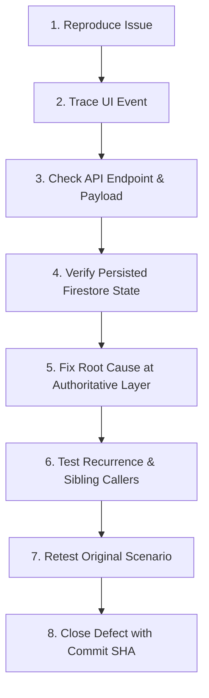

# TALASYS — Hands-On Defect Register

**Document Version:** 1.1.0 (MT01–MT03 Pre-Manual Testing Readiness)
**Target Environment:** Local Staging / Deployed Acceptance Environment
**Repository:** `jsphhbna/TALASYS`
**Branch:** `main`
**Baseline Verified Commit:** `e83f35c776e98669f713c9db43269723710d31a1`
**Associated Test Plan:** [`docs/HANDS_ON_ACCEPTANCE_TEST_PLAN.md`](file:///c:/Users/Administrator/Downloads/TALASYS/docs/HANDS_ON_ACCEPTANCE_TEST_PLAN.md)

This register tracks all observable defects, functional failures, UI regressions, and unexpected edge behaviors discovered during hands-on acceptance testing of TALASYS.

---

## 1. Readiness Gate & Baseline Status

Prior to human testing, the project is gated by the 5-stage readiness framework defined in Section A of [`docs/HANDS_ON_ACCEPTANCE_TEST_PLAN.md`](file:///c:/Users/Administrator/Downloads/TALASYS/docs/HANDS_ON_ACCEPTANCE_TEST_PLAN.md):

| Stage | Name | Status | Summary |
|---|---|---|---|
| **Stage 1** | **Source Ready** | **VERIFIED** | Code committed on `main`, clean working tree, clean build (`npm run build`). |
| **Stage 2** | **Locally Verified** | **VERIFIED** | All automated suites pass: unit (293/293), rules (24/24), emulator (89/89), E2E auth, typecheck (0 errors), lint clean. |
| **Stage 3** | **Staging Ready** | **PENDING** | Requires tester to provision staging instance, verify Firebase project, and confirm test accounts exist. |
| **Stage 4** | **Manual Testing Started** | **NOT STARTED** | Awaiting tester execution of 56 test cases across Resident, Admin, Super Admin, Negative, and Viewport suites. |
| **Stage 5** | **Acceptance Passed** | **PENDING** | All test cases executed with `PASS` or approved `Accepted Limitation`. |

---

## 2. Defect Status Definitions

| Status | Meaning |
|---|---|
| **New** | Defect has been discovered and logged by a tester, awaiting reproduction. |
| **Reproduced** | Defect has been confirmed and reproduced by the engineering/testing team. |
| **In Progress** | Root cause identified; code correction is currently being developed. |
| **Fixed** | Fix committed to repository with regression test evidence; ready for retest. |
| **Retesting** | Tester is re-executing the original failure scenario against the updated build. |
| **Closed** | Retest verified clean pass without side-effects; defect officially resolved. |
| **Not Reproducible** | Behavior could not be reproduced after multiple attempts across specified environments. |
| **Accepted Limitation** | Known constraint or architectural boundary agreed with stakeholders as acceptable for capstone scope. |

---

## 3. Defect Handling Contract

When testers report an issue, the following lifecycle contract must be strictly followed:



1. **Reproduce:** Confirm exact preconditions, steps, browser viewport, and user account role.
2. **Trace UI:** Inspect browser console logs, React component state, and network tab calls.
3. **Check API:** Verify HTTP request headers, payload parameters, and server response codes.
4. **Verify Firestore:** Check database documents and security rules to confirm persisted state.
5. **Fix Root Cause:** Apply the smallest maintainable fix at the authoritative server/policy layer.
6. **Test Recurrence:** Search alternative paths performing similar operations to avoid recurrence.
7. **Retest Original Scenario:** Execute the original reproduction steps against the clean build.
8. **Close Defect:** Record fix commit SHA, date, and verification status in this register.

---

## 4. Active Defect Ledger

*(Initial baseline: V01–V04 and MT01 remediations are closed and verified clean in automated tests. Zero open defects prior to manual testing.)*

| Defect ID | Test Case ID | Role | Page / URL | Action Performed | Expected Behavior | Actual Behavior | Severity | Status | Root Cause | Fix Commit | Retest Result |
|---|---|---|---|---|---|---|---|---|---|---|---|
| *DEF-BASE-01* | TC-ADM-10 | Document Processor | `/admin/generate` | Reprint completed request | Allow authorized reprint of already-generated completed request | Previously returned 409 "Cannot transition terminal request" | High | **Closed** | `request.markGenerated` rejected Completed status without checking `isReprint` and prior issuance | MT01 Commit | PASS (Automated unit, emulator & E2E) |
| *DEF-BASE-02* | TC-RES-07, TC-RES-12 | Resident | `/resident/requests` | Navigate to new request or request history | Open valid pages | Routes were misdocumented as `/resident/requests/new` and `/resident/requests` | Medium | **Closed** | Mismatched documentation of App Router paths | MT02 Commit | PASS (Verified against real App Router pages) |

---

## 5. Defect Submission Template for Human Testers

When submitting a new defect, testers must provide the following information:

```markdown
### Defect Report: [Short Title]
- **Test Case ID:** (e.g., TC-RES-07, TC-ADM-10, TC-SA-08, TC-NEG-11)
- **Role:** Resident / Admin: View Only / Admin: Verification / Admin: Document Processing / Admin: Manager / Admin: Full Access / Super Admin
- **Page / URL:** (e.g., /admin/generate, /superadmin/config, /resident/request, /resident/history)
- **Action Performed:** (Exact click, input, or submission)
- **Expected Behavior:** (What should have occurred per test plan)
- **Actual Behavior:** (What was observed instead)
- **Reproduction Steps:**
  1. ...
  2. ...
  3. ...
- **Screenshot / Screen Recording:** [Attached or URL]
- **Console / Network Errors:** (Copy from F12 DevTools Console & Network tab)
- **Severity:** Critical (Blocks testing) / High (Major feature broken) / Medium (Workaround available) / Low (Cosmetic/Polish)
- **Environment:** Browser (Chrome/Firefox/Safari/Edge), OS, Screen Viewport (e.g. 390x844)
```
