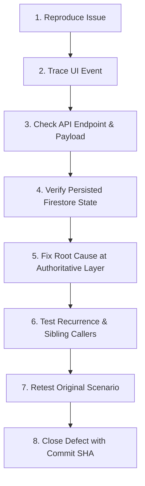

# TALASYS — Hands-On Defect Register

This register tracks all observable defects, functional failures, UI regressions, and unexpected edge behaviors discovered during hands-on acceptance testing of TALASYS.

---

## 1. Defect Status Definitions

| Status | Meaning |
|---|---|
| **New** | Defect has been discovered and logged by a tester, awaiting reproduction. |
| **Reproduced** | Defect has been confirmed and reproduced by the engineering/testing team. |
| **In Progress** | Root cause identified; code correction is currently being developed. |
| **Fixed** | Fix committed to repository with regression test evidence; ready for retest. |
| **Retesting** | Tester is re-executing the original failure scenario against the updated build. |
| **Closed** | Retest verified clean pass without side-effects; defect officially resolved. |
| **Not Reproducible** | Behavior could not be reproduced after multiple attempts across specified environments. |
| **Accepted Limitation** | Known constraint or architectural boundary agreed with stakeholders as acceptable for capstone scope. |

---

## 2. Defect Handling Contract

When testers report an issue, the following lifecycle contract must be strictly followed:



1. **Reproduce:** Confirm exact preconditions, steps, browser viewport, and user account role.
2. **Trace UI:** Inspect browser console logs, React component state, and network tab calls.
3. **Check API:** Verify HTTP request headers, payload parameters, and server response codes.
4. **Verify Firestore:** Check database documents and security rules to confirm persisted state.
5. **Fix Root Cause:** Apply the smallest maintainable fix at the authoritative server/policy layer.
6. **Test Recurrence:** Search alternative paths performing similar operations to avoid recurrence.
7. **Retest Original Scenario:** Execute the original reproduction steps against the clean build.
8. **Close Defect:** Record fix commit SHA, date, and verification status in this register.

---

## 3. Active Defect Ledger

*(Initial state: Clean baseline with V01–V04 closed. All new findings from human acceptance testing will be recorded below.)*

| Defect ID | Test Case ID | Role | Page / URL | Action Performed | Expected Behavior | Actual Behavior | Severity | Status | Root Cause | Fix Commit | Retest Result |
|---|---|---|---|---|---|---|---|---|---|---|---|
| *None* | — | — | — | — | — | — | — | **No open defects** | Baseline verified | `HEAD` | PASS |

---

## 4. Defect Submission Template for Human Testers

When submitting a new defect, testers must provide the following information:

```markdown
### Defect Report: [Short Title]
- **Test Case ID:** (e.g., TC-RES-07, TC-ADM-10, TC-SA-08)
- **Role:** Resident / Admin (Role) / Super Admin / Anonymous
- **Page / URL:** (e.g., /admin/generate, /superadmin/config)
- **Action Performed:** (Exact click, input, or submission)
- **Expected Behavior:** (What should have occurred)
- **Actual Behavior:** (What was observed instead)
- **Reproduction Steps:**
  1. ...
  2. ...
  3. ...
- **Screenshot / Screen Recording:** [Attached or URL]
- **Console / Network Errors:** (Copy from F12 DevTools Console & Network tab)
- **Severity:** Critical (Blocks testing) / High (Major feature broken) / Medium (Workaround available) / Low (Cosmetic/Polish)
- **Environment:** Browser (Chrome/Firefox/Safari/Edge), OS, Screen Viewport (e.g. 390x844)
```
