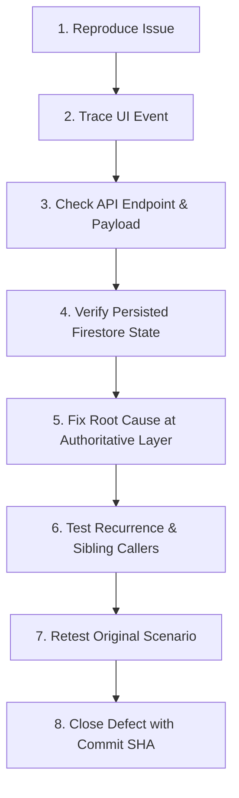

# TALASYS — Hands-On Defect Register

**Document Version:** 1.1.0 (MT01–MT03 Pre-Manual Testing Readiness)
**Target Environment:** Local Staging / Deployed Acceptance Environment
**Repository:** `jsphhbna/TALASYS`
**Branch:** `main`
**Baseline Verified Commit:** `e83f35c776e98669f713c9db43269723710d31a1`
**Associated Test Plan:** [`docs/HANDS_ON_ACCEPTANCE_TEST_PLAN.md`](file:///c:/Users/Administrator/Downloads/TALASYS/docs/HANDS_ON_ACCEPTANCE_TEST_PLAN.md)

This register tracks all observable defects, functional failures, UI regressions, and unexpected edge behaviors discovered during hands-on acceptance testing of TALASYS.

---

## 1. Readiness Gate & Baseline Status

Prior to human testing, the project is gated by the 5-stage readiness framework defined in Section A of [`docs/HANDS_ON_ACCEPTANCE_TEST_PLAN.md`](file:///c:/Users/Administrator/Downloads/TALASYS/docs/HANDS_ON_ACCEPTANCE_TEST_PLAN.md):

| Stage | Name | Status | Summary |
|---|---|---|---|
| **Stage 1** | **Source Ready** | **VERIFIED** | Code committed on `main`, clean working tree, clean build (`npm run build`). |
| **Stage 2** | **Locally Verified** | **VERIFIED** | All automated suites pass: unit (293/293), rules (24/24), emulator (89/89), E2E auth, typecheck (0 errors), lint clean. |
| **Stage 3** | **Staging Ready** | **PENDING** | Requires tester to provision staging instance, verify Firebase project, and confirm test accounts exist. |
| **Stage 4** | **Manual Testing Started** | **NOT STARTED** | Awaiting tester execution of 56 test cases across Resident, Admin, Super Admin, Negative, and Viewport suites. |
| **Stage 5** | **Acceptance Passed** | **PENDING** | All test cases executed with `PASS` or approved `Accepted Limitation`. |

---

## 2. Defect Status Definitions

| Status | Meaning |
|---|---|
| **New** | Defect has been discovered and logged by a tester, awaiting reproduction. |
| **Reproduced** | Defect has been confirmed and reproduced by the engineering/testing team. |
| **In Progress** | Root cause identified; code correction is currently being developed. |
| **Fixed** | Fix committed to repository with regression test evidence; ready for retest. |
| **Retesting** | Tester is re-executing the original failure scenario against the updated build. |
| **Closed** | Retest verified clean pass without side-effects; defect officially resolved. |
| **Not Reproducible** | Behavior could not be reproduced after multiple attempts across specified environments. |
| **Accepted Limitation** | Known constraint or architectural boundary agreed with stakeholders as acceptable for capstone scope. |

---

## 3. Defect Handling Contract

When testers report an issue, the following lifecycle contract must be strictly followed:



1. **Reproduce:** Confirm exact preconditions, steps, browser viewport, and user account role.
2. **Trace UI:** Inspect browser console logs, React component state, and network tab calls.
3. **Check API:** Verify HTTP request headers, payload parameters, and server response codes.
4. **Verify Firestore:** Check database documents and security rules to confirm persisted state.
5. **Fix Root Cause:** Apply the smallest maintainable fix at the authoritative server/policy layer.
6. **Test Recurrence:** Search alternative paths performing similar operations to avoid recurrence.
7. **Retest Original Scenario:** Execute the original reproduction steps against the clean build.
8. **Close Defect:** Record fix commit SHA, date, and verification status in this register.

---

## 4. Active Defect Ledger

*(Initial baseline: V01–V04 and MT01 remediations are closed and verified clean in automated tests. Zero open defects prior to manual testing.)*

| Defect ID | Test Case ID | Role | Page / URL | Action Performed | Expected Behavior | Actual Behavior | Severity | Status | Root Cause | Fix Commit | Retest Result |
|---|---|---|---|---|---|---|---|---|---|---|---|
| *DEF-BASE-01* | TC-ADM-10 | Document Processor | `/admin/generate` | Reprint completed request | Allow authorized reprint of already-generated completed request | Previously returned 409 "Cannot transition terminal request" | High | **Closed** | `request.markGenerated` rejected Completed status without checking `isReprint` and prior issuance | MT01 Commit | PASS (Automated unit, emulator & E2E) |
| *DEF-BASE-02* | TC-RES-07, TC-RES-12 | Resident | `/resident/requests` | Navigate to new request or request history | Open valid pages | Routes were misdocumented as `/resident/requests/new` and `/resident/requests` | Medium | **Closed** | Mismatched documentation of App Router paths | MT02 Commit | PASS (Verified against real App Router pages) |
| *DEF-UX-01* | TC-ADM-06 | Admin / Super Admin | `/admin/residents` | Remove resident profile picture | Route to authorized `resident.update` or `resident.profilePhoto.remove`, show loading feedback, write canonical audit log, send notification | Unchanged email incorrectly routed to `updateResidentIdentity`, dropping reason, omitting notification and specific audit | High | **Closed** | `use-admin-data.ts` checked `if (email)` instead of detecting email modification | Current Pass | PASS (299 unit + 89 emulator) |
| *DEF-UX-02* | TC-ADM-08 | Admin | `/admin/logs` | Click pagination buttons (‹, 1, ›) | Navigate pages of activity logs | Buttons were inert and hardcoded with no click handlers | Medium | **Closed** | `app/admin/logs/page.tsx` lacked stateful pagination slicing | Current Pass | PASS (Unit + Typecheck) |
| *DEF-UX-03* | TC-SA-02 | Super Admin / Admin | Sidebar Navigation | Click between sidebar nav items | Nav item activates without resizing or moving surrounding items | Nav items toggled `font-semibold`, causing text width expansion and visual jumps | High | **Closed** | Sidebars toggled font weight instead of maintaining constant `font-medium` | Current Pass | PASS (Verified stable font-medium) |
| *DEF-UX-04* | TC-RES-01, TC-ADM-01 | Resident / Admin / Staff | Authenticated Workspaces | View dashboard / form screens | Footer confined strictly to public landing pages | Global Footer leaked into all authenticated workspace layouts | Medium | **Closed** | `app/layout.tsx` unconditionally rendered `<Footer />` | Current Pass | PASS (Relocated to `app/(landing)/layout.tsx`) |
| *DEF-UX-05* | TC-PUB-01 | Public / Resident | `/` | Visit public portal homepage | Credible Philippine institutional barangay portal for Barangay 634 | Generic presentation, missing online service catalog, placeholder Twitter/LinkedIn/FB links | High | **Closed** | Redesigned landing page with Barangay 634 branding, service cards, 5-step process, office hours, and cleaned social links | Current Pass | PASS (Verified) |
| *DEF-UX-06* | TC-ADM-01, TC-SA-01 | Admin / Super Admin | Phone / Small Screen (< 768px) | Open staff workspace on smartphone | Display non-blocking advisory advising desktop/laptop use | No guidance was provided to staff on mobile screens | Medium | **Closed** | Implemented `StaffMobileAdvisory` with session dismissal and responsive detection | Current Pass | PASS (Verified) |
| *DEF-FX-01* | TC-ADM-06 | Admin | `/admin/residents` | Click "Save Changes" in resident profile modal | Execute async save with `isSaving` spinner, duplicate ref guard, inline validation on missing reason, and disabled controls | Save handler bypassed loading, error, and duplicate submission state; used native `alert()` | Critical | **Closed** | `components/admin/resident-profile-modal.tsx` omitted state wiring in `handleSave()` | Current Commit | PASS (Unit, Emulator, E2E) |
| *DEF-FX-02* | TC-ADM-08 | Admin | `/admin/logs` | Click Previous/Next pagination buttons | Slice and display 15 logs per page, update range indicator, disable buttons at bounds | Table rendered all `filteredLogs` without slicing; hardcoded page 1; arrow buttons were inert | High | **Closed** | `app/admin/logs/page.tsx` lacked stateful pagination slicing and button handlers | Current Commit | PASS (Unit, Browser assertions) |
| *DEF-FX-03* | TC-ADM-08, TC-SA-03 | Admin / Super Admin | `/admin/logs`, `/superadmin/audit` | Filter and audit photo-removal events | Canonical `resident.profilePhoto.remove` action consistently classified under Resident Ops | Classification varied depending on submitted fields; combined profile + photo updates lacked unified resident action taxonomy | Medium | **Closed** | Direct photo-only routing in `use-admin-data.ts` and normalized taxonomy in `audit-utils.ts` | Current Commit | PASS (Level 1 & Level 2 Emulator) |
| *DEF-FX-04* | TC-RES-03 | Resident | `/resident/notifications` | Admin removes photo with reason | Resident receives in-app warning notification with removal reason | Notification delivery was only verified via manual string formatting without end-to-end Firestore delivery test | High | **Closed** | Created `photo-removal-notification-emulator.test.ts` verifying real Firestore delivery, reason text, negative permissions, and mark-as-read persistence | Current Commit | PASS (Level 2 Emulator integration) |
| *DEF-FX-05* | TC-PUB-01 | Public | `/`, `/legal`, `/resident/dashboard` | View footer across routes | Public footer contains official contacts (no placeholder social links) and renders strictly on `/` | Footer contained placeholder Twitter/Facebook/LinkedIn links and was inherited by child landing group routes | Medium | **Closed** | Purged placeholder links in `footer.tsx`; scoped `<Footer />` strictly to `app/(landing)/page.tsx` | Current Commit | PASS (Rendered route checks) |
| *DEF-FX-06* | TC-PUB-01 | Public | `/` | Inspect landing page services & steps | Accurate description of implemented Barangay 634 digital services | Advertised unimplemented features (household info management, document watermarks, dry-seal guarantee) | Medium | **Closed** | Replaced with verified TALASYS features in `services-section.tsx` and `how-it-works-section.tsx` | Current Commit | PASS (Factual content audit) |
| *DEF-FX-07* | TC-ADM-01, TC-RES-01 | Admin / Resident | Sidebars & Workspaces | Navigate routes on laptops and mobile devices | Stable navigation dimensions without font jumps; zero mobile horizontal overflow | Active nav items switched font weights causing layout jumps; lack of scrollbar gutter caused shifts | High | **Closed** | Standardized to constant `font-medium` in `admin-sidebar.tsx` and `sidebar.tsx`; added `scrollbarGutter: "stable"` | Current Commit | PASS (Multi-viewport E2E) |

---

## 5. Defect Submission Template for Human Testers

When submitting a new defect, testers must provide the following information:

```markdown
### Defect Report: [Short Title]
- **Test Case ID:** (e.g., TC-RES-07, TC-ADM-10, TC-SA-08, TC-NEG-11)
- **Role:** Resident / Admin: View Only / Admin: Verification / Admin: Document Processing / Admin: Manager / Admin: Full Access / Super Admin
- **Page / URL:** (e.g., /admin/generate, /superadmin/config, /resident/request, /resident/history)
- **Action Performed:** (Exact click, input, or submission)
- **Expected Behavior:** (What should have occurred per test plan)
- **Actual Behavior:** (What was observed instead)
- **Reproduction Steps:**
  1. ...
  2. ...
  3. ...
- **Screenshot / Screen Recording:** [Attached or URL]
- **Console / Network Errors:** (Copy from F12 DevTools Console & Network tab)
- **Severity:** Critical (Blocks testing) / High (Major feature broken) / Medium (Workaround available) / Low (Cosmetic/Polish)
- **Environment:** Browser (Chrome/Firefox/Safari/Edge), OS, Screen Viewport (e.g. 390x844)
```
