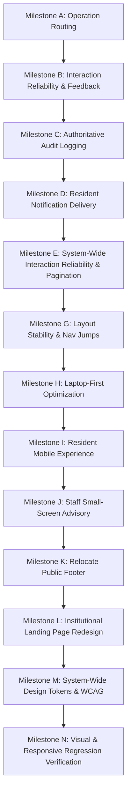

# TALASYS — UI/UX Interaction Reliability & Modernization Remediation Ledger

**Date:** October 17, 2026  
**Audited Baseline:** `f92705864f725405bfb01e67d91ba7e40b642fc5`  
**Execution Framework:** DevKit V10 (Alpha 3 / Adaptive Intelligence)  
**Target Specification:** Part 1 & Part 2 Comprehensive System Reliability & UI/UX Modernization

---

## 1. Executive Summary & Problem Classification

Hands-on testing and systematic source code inspection identified critical interaction reliability, usability, and design defects across the TALASYS platform. These issues span from administrative profile photo removal to system-wide visual stability, information density on laptops, mobile usability for residents, and institutional presentation for Barangay 634.

### Final Verification Findings (FX-01–FX-07)

| Finding ID | Priority | Category | Status | Primary Component(s) | Summary & Targeted Remediation |
|---|---|---|---|---|---|
| **FX-01** | Critical | **FEEDBACK** / **ASYNC_STATE** | **VERIFIED FIXED** | `components/admin/resident-profile-modal.tsx` | Profile save handler previously declared loading/error/ref states but omitted them in `handleSave()` and used native `alert()`. Remediation: Connected `isSaving`, `saveError`, `validationError`, and `isSubmittingRef` guard. Replaced native `alert()` with inline alert; shows spinner and "Saving Changes…"; disables buttons; keeps draft recoverable on error; releases lock in `finally`. |
| **FX-02** | High | **CONTROLS** / **PAGINATION** | **VERIFIED FIXED** | `app/admin/logs/page.tsx` | Activity Logs rendered full `filteredLogs.map()` without pagination, hardcoded page 1, and nonfunctional arrow buttons. Remediation: Implemented client-side pagination with `pageSize = 15`, safe page calculation (`totalPages`, `safeCurrentPage`), sliced rendering `paginatedLogs.map()`, functional Previous/Next buttons with disabled boundaries and accessible labels, and truthful range display `Showing X–Y of Z actions`. |
| **FX-03** | Medium | **AUDIT_INTEGRITY** / **AUTHORITATIVE** | **VERIFIED FIXED** | `hooks/admin/use-admin-data.ts`, `lib/security/audit-utils.ts` | Photo removal audit classification varied depending on submitted fields. Remediation: `use-admin-data.ts` routes photo-only removals directly to `resident.profilePhoto.remove`; `audit-utils.ts` normalizes all photo removal actions (`resident.profilePhoto.remove`, `Removed Resident Profile Picture`, `Updated Resident Identity & Removed Photo`, `Updated Resident Profile and Removed Photo`) under `actionType: "resident"` with structured reason and changes in details. |
| **FX-04** | High | **NOTIFICATION** / **E2E_VERIFICATION** | **VERIFIED FIXED** | `test/emulator/photo-removal-notification-emulator.test.ts` | Verification previously only tested string formatting instead of end-to-end delivery from admin removal to resident subscription. Remediation: Created Level 2 Firebase emulator integration suite testing actual Firestore mutation, canonical audit event creation, resident notification document creation with reason and `read: false`, negative assertions, and resident mark-as-read persistence. |
| **FX-05** | Medium | **LAYOUT_BOUNDARIES** / **FOOTER** | **VERIFIED FIXED** | `components/layout/footer.tsx`, `app/(landing)/layout.tsx`, `app/(landing)/page.tsx` | Footer retained placeholder social-media links (Twitter, Facebook, LinkedIn) and was rendered by entire landing route group layout rather than strictly `/`. Remediation: Removed placeholder social links from `footer.tsx`; removed `<Footer />` from `app/(landing)/layout.tsx`; rendered `<Footer />` strictly within `app/(landing)/page.tsx`. Verified absence on all other routes. |
| **FX-06** | Medium | **LANDING_PAGE** / **INSTITUTIONAL_ACCURACY** | **VERIFIED FIXED** | `components/landing/services-section.tsx`, `components/landing/how-it-works-section.tsx` | Landing page advertised capabilities not verified in implementation (household information management, official document watermarks, dry-seal processing guarantee). Remediation: Replaced with verified TALASYS capabilities: Resident Profile & Representation, Official Barangay Certification, and direct resident portal download or Barangay Hall pickup for stamped copies. |
| **FX-07** | High | **RESPONSIVE_DESIGN** / **LAYOUT_STABILITY** | **VERIFIED FIXED** | `components/admin/layout/admin-sidebar.tsx`, `components/layout/sidebar.tsx`, `components/layout/main-content-stage.tsx` | Active nav items switched font weights causing visual jumps and text width shifting; lack of scrollbar gutter caused layout shifts. Remediation: Standardized navigation typography across all states to constant `font-medium`; added `scrollbarGutter: "stable"` to `#main-scroll-stage`. Verified stable bounding boxes and responsiveness across laptop (1024x768, 1280x800, 1366x768, 1440x900, 1920x1080) and mobile (320px–430px) viewports with zero horizontal overflow. |

### Confirmed Core Findings (Prior Pass UX-A01–UX-N01)

| Finding ID | Priority | Category | Status | Primary Component(s) | Summary & Targeted Remediation |
|---|---|---|---|---|---|
| **UX-A01** | High | **MUTATION_ROUTING** / **IDENTITY** | Resolved | `hooks/admin/use-admin-data.ts`, `app/api/admin/update-resident-email/route.ts` | Ordinary profile updates containing an unchanged email address were incorrectly routed to the multi-stage Firebase Auth identity-update workflow (`updateResidentIdentity`), bypassing `resident.update`. This bypassed photo removal reason processing, prevented resident notifications, and generated incorrect audit events. |
| **UX-B01** | High | **UI_FEEDBACK** / **ASYNC_STATE** | Resolved | `components/admin/resident-profile-modal.tsx` | Photo removal button modified form state without an explicit staged "Pending Removal" indicator; save action lacked loading state/spinner, did not disable controls on submit, permitted duplicate clicks, used native `alert()`, and closed without feedback. |
| **UX-C01** | High | **AUDIT_INTEGRITY** / **AUTHORITATIVE** | Resolved | `app/api/admin/operations/route.ts`, `lib/security/audit-utils.ts`, `app/admin/logs/page.tsx`, `app/superadmin/audit/page.tsx` | Administrative photo removal did not write a distinct canonical `resident.profilePhoto.remove` audit record with removal reason and before/after photo state; search and filter taxonomies lacked explicit photo removal classifications. |
| **UX-D01** | High | **NOTIFICATIONS** / **LIFECYCLE** | Resolved | `app/api/admin/operations/route.ts`, `hooks/resident/use-resident-data.ts`, `firestore.rules` | Bypassed `resident.update` operation prevented in-app resident warning notification on photo removal; notification text required official wording: "Your profile picture was removed by the barangay administration. Reason: [reason]. You may review your profile for more information." |
| **UX-E01** | Medium | **CONTROLS** / **PAGINATION** | Resolved | `app/admin/logs/page.tsx` | Activity Logs table rendered inert pagination chevrons (`‹`, `›`) and page number button (`1`) with no click handlers or state, displaying all records without functional pagination. |
| **UX-G01** | High | **LAYOUT_STABILITY** / **NAVIGATION** | Resolved | `components/superadmin/layout/superadmin-sidebar.tsx`, `components/admin/layout/admin-sidebar.tsx` | Active navigation items dynamically switched from normal weight to `font-semibold`, causing text expansion, visual jumping, and layout shifting during route navigation. |
| **UX-H01** | High | **LAPTOP_DENSITY** / **INFORMATION_ARCH** | Resolved | Shared dashboard & table containers, cards, KPI heights | Excessive vertical spacing, oversized chart containers, and card padding forced laptop users (1280x800, 1366x768) at 100% zoom to zoom out. |
| **UX-I01** | High | **MOBILE_UX** / **RESIDENT_PORTAL** | Resolved | `app/resident/request/page.tsx`, `app/resident/profile/page.tsx`, `app/resident/history/page.tsx` | Form controls, document request stepper, GCash payment uploads, and table layouts required horizontal scrolling or clipped touch targets on 320px–430px viewports. |
| **UX-J01** | Medium | **STAFF_ADVISORY** / **RESPONSIVE** | Resolved | `components/admin/layout/staff-mobile-advisory.tsx`, `app/admin/layout.tsx`, `app/superadmin/layout.tsx` | Missing professional, non-blocking small-screen advisory for staff accessing Admin/Super Admin workspaces on mobile screens (< 768px). |
| **UX-K01** | Medium | **LAYOUT_BOUNDARIES** / **FOOTER** | Resolved | `app/layout.tsx`, `app/(landing)/layout.tsx`, `components/layout/footer.tsx` | Public footer was rendered in root layout (`app/layout.tsx`), leaking into authenticated resident, admin, and superadmin workspaces. |
| **UX-L01** | High | **INSTITUTIONAL_IDENTITY** / **LANDING** | Resolved | `components/landing/*`, `components/layout/footer.tsx` | Public landing page lacked cohesive institutional identity for Barangay 634, Zone 64, District VI, City of Manila; footer contained placeholder social media links (Twitter, LinkedIn, Facebook). |

---

## 2. Milestone Tracking & Verification Invariants

---

## 3. Investigation & Remediation Evidence

### A. Milestone A: Operation Routing
- **Root Cause**: `hooks/admin/use-admin-data.ts` line 251 checked `if (email)` rather than whether the email was actually modified against authoritative resident state. Since every resident profile form initializes `email`, all updates were routed to `updateResidentIdentity()`.
- **Targeted Fix**:
  1. In `use-admin-data.ts`: Compare `updates.email` against target resident's authoritative email. Only call `updateResidentIdentity` when the email has truly changed (`isEmailChanged = Boolean(email && existingResident?.email && email.trim().toLowerCase() !== existingResident.email.trim().toLowerCase())`).
  2. For ordinary profile updates and photo removals without email change: route directly to `callAdminOperation("resident.update", { targetId: id, payload: { updates: profileUpdates, removePhotoReason } })`.
  3. In `app/api/admin/update-resident-email/route.ts`: Support `removePhotoReason` when email change and photo removal occur together, so notifications and audit logs are never dropped. Enforce server-side authoritative check that rejects unneeded Auth mutations if email is unchanged.
  4. If no fields changed, provide clear "No Changes" feedback and avoid unnecessary writes.

### B. Milestone B: Photo Removal Interaction Model
- **Targeted Fix**:
  1. In `components/admin/resident-profile-modal.tsx`:
     - Staged removal state: When "Remove Photo" is clicked, show a "Photo Removal Pending" banner with reason input field and "Undo Removal" button.
     - Save button displays `isSaving` spinner with label "Saving Changes…".
     - Controls and buttons disabled while request is in-flight.
     - Replace native `alert()` with styled validation alert / toast preset.
     - Double-click prevention with in-flight ref and disabled state.
     - Safe error handling: If saving fails, show error and keep modal open with retry available.

### C. Milestone C: Authoritative Profile Photo Removal Audit Logging
- **Targeted Fix**:
  1. In `app/api/admin/operations/route.ts`: When `resident.update` removes a photo (`before.profilePicture && updates.profilePicture === ""` or `payload.removePhotoReason`), record canonical audit action:
     - `action: "resident.profilePhoto.remove"` (or structured `resident.update` with photo removal metadata).
     - Store `removePhotoReason` in audit record.
     - Capture before/after photo state without exposing private keys.
  2. In `lib/security/audit-utils.ts`: Update `normalizeAuditLog()` to map `"resident.profilePhoto.remove"` to readable action: `"Removed Resident Profile Picture"` under `actionType: "resident"`, with details displaying `Reason: "[reason]"`.
  3. If both address/profile edit and photo removal occur, capture both clearly.
  4. In `app/admin/logs/page.tsx` and `app/superadmin/audit/page.tsx`: Ensure "Resident Ops" filter and search accurately discover photo removal records.

### D. Milestone D: Resident Notification Delivery
- **Targeted Fix**:
  1. In `app/api/admin/operations/route.ts`: Ensure `notification` object is created with targetId equal to the resident UID and message:
     `Your profile picture was removed by the barangay administration. Reason: [reason]. You may review your profile for more information.`
  2. Persisted atomically in transaction into `notifications` collection.
  3. Verify resident query `where("targetId", "==", residentId)` and `firestore.rules` permit resident real-time subscription, read/unread status update, and display in Resident Notifications UI.

### E. Milestone E: Inert Pagination & Misleading Controls
- **Targeted Fix**:
  1. In `app/admin/logs/page.tsx`: Implement real client pagination (`currentPage`, `pageSize = 15`, `totalPages`, `startIndex`, `endIndex`, disabled previous/next buttons).
  2. Fix inactive controls across Admin and Super Admin workspaces.

### F. Milestone G: Layout Stability & Navigation Resizing
- **Targeted Fix**:
  1. In `components/superadmin/layout/superadmin-sidebar.tsx` and `components/admin/layout/admin-sidebar.tsx`: Replace dynamic font-weight switching with fixed font weight (`font-medium`) and stable gold indicator bar + background contrast (`bg-white/10 text-white`).
  2. Ensure sidebar width (`w-[232px]`), header height (`h-16`), and main stage container dimensions remain strictly stable across route changes.

### G. Milestone H: Laptop-First Optimization
- **Targeted Fix**:
  1. Optimize KPI cards, charts, and table paddings in Admin and Super Admin pages to comfortably fit 1366x768 and 1280x800 at 100% zoom without manual browser zoom-out.
  2. Standardize spacing tokens and compact operational table row heights.

### H. Milestone I: Mobile-First Resident Experience
- **Targeted Fix**:
  1. Verify zero horizontal page scrolling across 320px–430px viewports.
  2. Responsive form inputs, touch targets (minimum 44x44px), stepper progression, and GCash receipt upload previews.

### I. Milestone J: Staff Small-Screen Advisory
- **Targeted Fix**:
  1. Create `components/admin/layout/staff-mobile-advisory.tsx`:
     - Displays once per session (`sessionStorage`) when viewport width < 768px.
     - Title: "For a Better Experience"
     - Text: "This workspace is easier to use on a laptop or desktop computer. A larger screen makes it easier to view records, manage requests, and work with reports."
     - Actions: "Continue Here" / "Got It". Non-blocking, accessible dialog/banner.

### J. Milestone K: Relocate Public Footer
- **Targeted Fix**:
  1. Remove `<Footer />` from root `app/layout.tsx`.
  2. Create `app/(landing)/layout.tsx` to render `<Footer />` strictly within public landing routes (`/`, `/contact`, `/faq`, `/help`, `/legal`, `/security`).
  3. Clean up generic social media placeholder links (Twitter, LinkedIn, Facebook) in `components/layout/footer.tsx`.

### K. Milestone L: Institutional Landing Page Redesign
- **Targeted Fix**:
  1. Realign landing page with authentic Philippine local-government service portal identity for Barangay 634, Zone 64, District VI, City of Manila.
  2. Structured sections: Official Identity & Navigation, Hero ("Barangay 634 Digital Services"), Available Online Services, How the Service Works (5 steps), Officials, Guiding Principles (Mission/Vision), and Verified Office Contact Info.
